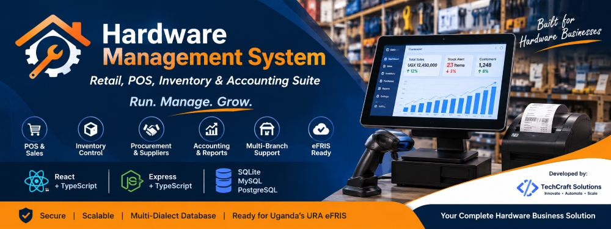
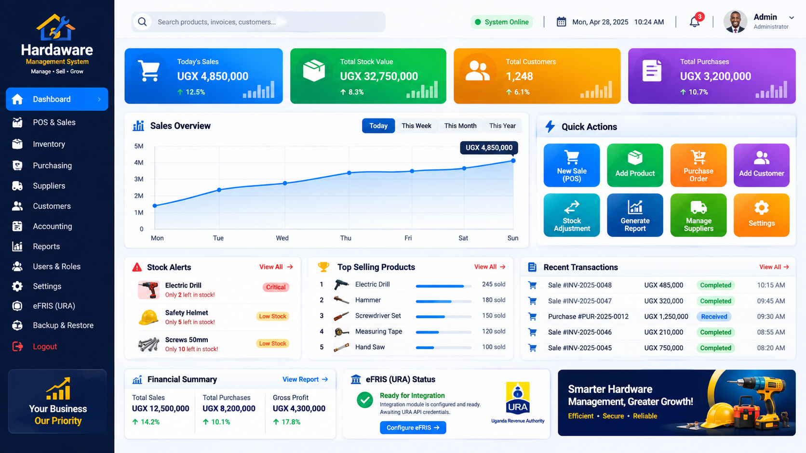
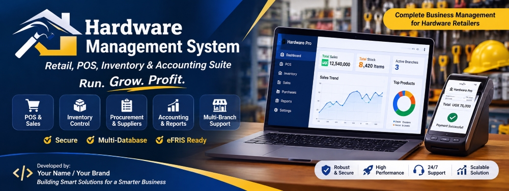

# 🏗️ Hardware Management System

### Enterprise-Ready Hardware Retail Management | Inventory | POS | Sales | Procurement | Financial Operations

## 

<p align="center">
  <strong>A Smarter Way to Manage Hardware Business Operations.</strong>
</p>

<p align="center">
  
  
  
  
</p>

<p align="center">
  <a href="https://pauldeveloper73.github.io/Kisakye-Paul-Elite-Portifolio/">Developer Portfolio</a> •
  <a href="https://github.com/pauldeveloper73">GitHub Projects</a> •
  <a href="mailto:kisakyepaul73@gmail.com">Business Enquiries</a> •
  <a href="https://wa.me/256774185964">WhatsApp</a>
</p>

---

## 📌 Project Overview

The **Hardware Management System** is a modern business management application designed to simplify, organize, and improve the daily operations of hardware stores, construction-material retailers, building-material suppliers, wholesalers, and distributors.

It provides a centralized platform for managing essential business activities, including inventory, point of sale, sales transactions, purchasing, suppliers, customers, stock movements, financial operations, and business reporting.

Instead of relying on disconnected spreadsheets, manual records, and multiple business applications, the system aims to bring essential hardware business operations into one organized digital environment.

The solution is designed around real-world retail workflows, with particular consideration for businesses operating in Uganda and the wider African market.

## **The vision is simple: give hardware business owners greater control over their inventory, sales, finances, employees, and overall business performance from one application.**

## Product preview Live demo

[**View Harware Management App– Live Application**](https://pauldeveloper73.github.io/hardware-app-pro/)

## 

---

## 🎯 The Business Problem

Hardware businesses deal with complex day-to-day operations.

A typical hardware store may manage hundreds or thousands of products, multiple suppliers, different measurement units, varying purchase and selling prices, customer credit accounts, cash transactions, stock movements, and daily financial records.

When these activities are managed manually or through disconnected systems, businesses can experience:

- Inaccurate stock records.
- Unexplained inventory losses.
- Difficulty tracking fast-moving products.
- Delayed sales reporting.
- Poor purchasing decisions.
- Unmanaged customer credit.
- Supplier payment discrepancies.
- Difficulty calculating actual profitability.
- Limited visibility into employee activities.
- Inconsistent financial records.
- Time-consuming business reporting.

The Hardware Management System addresses these challenges through a centralized, structured, and scalable business management platform.

---

## 💡 The Solution

The application is designed to provide a unified operational environment where business owners and authorized employees can manage their responsibilities efficiently.

| Business Challenge             | Proposed Solution                      |
| ------------------------------ | -------------------------------------- |
| Manual stock tracking          | Centralized inventory management       |
| Slow checkout processes        | Integrated Point of Sale               |
| Unorganized sales records      | Digital sales and invoice management   |
| Poor purchasing visibility     | Procurement and purchase management    |
| Supplier payment confusion     | Supplier transaction tracking          |
| Unmanaged customer accounts    | Customer and credit management         |
| Stock discrepancies            | Traceable stock movement records       |
| Limited financial visibility   | Financial summaries and reporting      |
| Manual business analysis       | Centralized reports and analytics      |
| Fiscal compliance requirements | Uganda URA eFRIS integration readiness |
| Multiple business locations    | Multi-branch architecture roadmap      |

---

# ✨ Core System Modules

The platform is organized into specialized modules that work together to support complete hardware business operations.

## 1. 📊 Business Intelligence Dashboard

A centralized business overview providing management with quick access to important business information.

**Key capabilities:**

- Daily sales overview.
- Weekly and monthly sales summaries.
- Total inventory valuation.
- Customer statistics.
- Supplier statistics.
- Purchase summaries.
- Revenue monitoring.
- Sales performance analytics.
- Top-selling products.
- Low-stock alerts.
- Recent transactions.
- Financial summaries.
- Quick business actions.
- Fiscal integration status overview.

The dashboard is designed to help business owners understand their operational position without navigating through multiple sections.

## 2. 🛒 Point of Sale (POS)

A dedicated sales interface designed for efficient hardware retail transactions.

**Key capabilities:**

- Product search.
- Barcode-scanner-friendly workflow.
- Product category filtering.
- Shopping cart management.
- Quantity adjustments.
- Product unit selection.
- Customer selection.
- Walk-in customer support.
- Discount management.
- Tax calculation readiness.
- Multiple payment methods.
- Cash payment and change calculation.
- Split payment support.
- Customer credit sales.
- Receipt generation.
- Receipt printing.
- Sales history.
- Held and resumed sales.
- Returns and refund workflows.

The POS is intended to support fast and accurate checkout operations while maintaining proper inventory and financial records.

## 3. 📦 Advanced Inventory Management

Designed to handle the diverse products commonly sold by hardware and construction-material businesses.

**Key capabilities:**

- Product registration and management.
- SKU management.
- Barcode management.
- Product categories and subcategories.
- Brands and manufacturers.
- Product descriptions and images.
- Purchase price management.
- Retail and wholesale pricing.
- Product variations.
- Stock quantity tracking.
- Stock adjustments.
- Stock movement history.
- Low-stock alerts.
- Reorder levels.
- Inventory valuation.
- Damaged stock tracking.
- Product returns.
- Serial-number tracking readiness.
- Warranty tracking readiness.
- Batch tracking where applicable.

**Hardware-specific measurement units:**

- Pieces.
- Boxes.
- Cartons.
- Bags.
- Kilograms.
- Grams.
- Litres.
- Metres.
- Feet.
- Rolls.
- Bundles.
- Pairs.
- Sets.
- Sheets.
- Tonnes.

This flexibility is important because hardware businesses frequently sell products using different measurement units and packaging quantities.

## 4. 🧾 Sales & Invoice Management

A structured sales management environment for recording and monitoring customer transactions.

**Key capabilities:**

- Sales records.
- Invoice generation.
- Unique invoice numbering.
- Customer-linked transactions.
- Payment tracking.
- Partial payments.
- Full payments.
- Outstanding balances.
- Discounts.
- Tax configuration.
- Sales returns.
- Refund workflows.
- Credit notes readiness.
- Invoice printing.
- Sales history.
- Transaction status monitoring.

## 5. 🛍️ Purchasing & Procurement

A purchasing management module designed to improve procurement and inventory replenishment.

**Key capabilities:**

- Purchase requisitions.
- Purchase orders.
- Supplier selection.
- Product purchasing.
- Purchase price tracking.
- Goods received notes.
- Partial goods receiving.
- Purchase history.
- Purchase returns.
- Supplier payments.
- Outstanding purchase balances.
- Procurement reporting.

The purchasing workflow is designed to ensure inventory is updated through properly recorded goods-receiving transactions rather than simply through purchase order creation.

## 6. 🚚 Supplier Management

A centralized supplier relationship management module.

**Key capabilities:**

- Supplier registration.
- Supplier profiles.
- Company information.
- Contact details.
- Supplier categorization.
- Purchase history.
- Supplier payment records.
- Outstanding supplier balances.
- Supplier statements.
- Supplier transaction history.

## 7. 👥 Customer Management

Organized customer records for retail, wholesale, and business customers.

**Key capabilities:**

- Customer registration.
- Individual and business customer profiles.
- Customer contact information.
- Customer categorization.
- Sales history.
- Payment history.
- Customer credit limits.
- Outstanding balances.
- Customer statements.
- Customer-specific pricing readiness.
- Customer transaction tracking.

## 8. 💰 Accounting & Financial Management

A financial management foundation designed to improve business visibility and accountability.

**Key capabilities:**

- Sales revenue monitoring.
- Purchase expenditure tracking.
- Operating expense management.
- Customer receivables.
- Supplier payables.
- Payment records.
- Cash monitoring.
- Mobile Money transaction recording.
- Bank payment records.
- Cost of goods sold.
- Gross profit monitoring.
- Net profit reporting readiness.
- Cash flow summaries.
- Financial reconciliation.

The system is designed to distinguish sales revenue, actual cash received, outstanding receivables, business expenses, cost of goods sold, and profitability.

## 9. 📈 Reports & Business Analytics

Business intelligence and reporting capabilities designed to support better decision-making.

**Available and planned report categories include:**

- Daily sales reports.
- Weekly sales reports.
- Monthly sales reports.
- Annual sales reports.
- Product performance reports.
- Inventory valuation.
- Stock movement reports.
- Low-stock reports.
- Purchase reports.
- Supplier reports.
- Customer reports.
- Payment reports.
- Expense reports.
- Profitability reports.
- Branch performance reports.
- Tax reporting readiness.

Reporting capabilities are intended to support date filtering, search, printing, and data exports.

## 10. 🇺🇬 Uganda URA eFRIS Integration Readiness

The system is designed with future integration into the Uganda Revenue Authority's Electronic Fiscal Receipting and Invoicing Solution (eFRIS) in mind.

The architecture is intended to support official fiscal invoice workflows once the applicable URA API documentation, credentials, endpoints, and integration requirements are available.

**Integration preparation includes:**

- Dedicated eFRIS integration module.
- Business tax configuration.
- TIN configuration.
- API configuration architecture.
- Fiscal invoice submission workflow.
- Fiscal document identification.
- Tax mapping configuration.
- Submission status tracking.
- Error handling.
- Retry management.
- Submission history.
- Fiscal document verification data handling.
- Integration monitoring.

**Important integration status:**

The system's eFRIS integration readiness should not be interpreted as completed URA API integration or certification. Actual fiscal submission requires the official URA integration specifications, credentials, implementation, and verification.

## 11. 🔐 User Management & Access Control

Designed to support businesses with multiple employees and operational responsibilities.

Potential user roles include:

- System Administrator.
- Business Owner.
- Business Manager.
- Branch Manager.
- Sales Manager.
- Cashier.
- Inventory Manager.
- Storekeeper.
- Procurement Officer.
- Accountant.
- Auditor.

The planned authorization architecture supports configurable permissions, user accountability, and restricted access to sensitive business operations.

## 12. 💾 Backup, Settings & Business Configuration

A centralized configuration environment designed to support business administration.

**Key capabilities and planned enhancements:**

- Business information.
- Business logo and branding.
- Currency configuration.
- Tax configuration.
- POS settings.
- Product settings.
- Inventory settings.
- Invoice and receipt settings.
- User permissions.
- Branch settings.
- eFRIS configuration.
- Notification preferences.
- Data export.
- Backup and recovery.

---

# 🎨 User Interface & Experience

The application follows a modern-classic enterprise dashboard design.

The interface emphasizes usability, information hierarchy, operational efficiency, and visual consistency.

### Design Highlights

- Deep navy sidebar.
- Professional blue accents.
- Clean white workspace.
- Color-coded business summary cards.
- Organized navigation.
- Business analytics panels.
- Stock alert components.
- Recent transaction tables.
- Quick-action shortcuts.
- Responsive dashboard layouts.
- Consistent forms and controls.
- Professional business typography.

### Design Objectives

- Make essential information easy to find.
- Reduce unnecessary navigation.
- Improve daily business workflows.
- Highlight important operational alerts.
- Maintain consistent experiences across modules.
- Support desktop, tablet, and mobile devices.

---

# 🧰 Technology Stack

## Current Frontend Prototype

| Technology            | Purpose                             |
| --------------------- | ----------------------------------- |
| HTML5                 | Application structure               |
| Tailwind CSS          | Responsive interface styling        |
| Vanilla JavaScript    | Application logic and interactions  |
| Browser Local Storage | Prototype data persistence          |
| SVG / Icon Assets     | Interface icons and visual elements |

## Target Production Architecture

The application is being positioned for a more comprehensive backend-driven architecture.

| Layer                      | Technology / Direction                  |
| -------------------------- | --------------------------------------- |
| Frontend                   | Existing frontend architecture          |
| Application Logic          | Modular JavaScript / backend services   |
| Local Development Database | MySQL/MariaDB via XAMPP                 |
| Future Production Database | PostgreSQL                              |
| Database Management        | Migrations and database abstraction     |
| API Architecture           | RESTful API                             |
| Authentication             | Secure session-based authentication     |
| Authorization              | Role-Based Access Control               |
| Fiscal Integration         | Official Uganda URA eFRIS APIs          |
| Deployment                 | Production-ready hosting infrastructure |

**Database strategy:** XAMPP MySQL/MariaDB is the immediate local development target. PostgreSQL is the intended future database option. Compatibility must be verified through migrations, queries, and integration tests before production deployment.

---

# 🏛️ System Architecture & Scalability

The long-term architecture is designed around modular business operations and separation of responsibilities.

### Architectural principles

- Modular application structure.
- Reusable UI components.
- Centralized business logic.
- Database abstraction.
- RESTful API communication.
- Secure authentication.
- Role-based authorization.
- Data validation.
- Transaction management.
- Audit logging.
- Configurable business settings.
- Integration-ready services.
- Maintainable code organization.

### Scalability Roadmap

The system is intended to evolve to support:

- Multiple branches.
- Multiple warehouses.
- Multiple cashiers.
- Large product catalogues.
- Multiple business accounts.
- Centralized reporting.
- Cloud deployment.
- External payment integrations.
- Official tax integrations.
- Mobile application support.

---

# 📂 Recommended Project Structure

The following is the recommended modular structure for the project as it evolves. The actual repository should reflect the implemented files and technologies rather than listing planned files as already completed.

```text
hardware-management-system/
│
├── README.md
├── index.html
├── package.json                  # If build tooling is configured
├── .gitignore
├── .env.example                  # Future backend configuration template
│
├── assets/
│   ├── images/
│   │   ├── logo.png
│   │   └── products/
│   │
│   └── icons/
│
├── css/
│   ├── styles.css
│   └── responsive.css
│
├── js/
│   ├── app.js                    # Application initialization
│   ├── navigation.js             # Sidebar and page navigation
│   ├── dashboard.js              # Dashboard functionality
│   ├── ui.js                      # Shared UI components
│   ├── notifications.js          # Notification handling
│   ├── validation.js             # Form validation
│   │
│   ├── modules/
│   │   ├── inventory.js
│   │   ├── pos.js
│   │   ├── sales.js
│   │   ├── purchases.js
│   │   ├── suppliers.js
│   │   ├── customers.js
│   │   ├── expenses.js
│   │   ├── accounting.js
│   │   ├── reports.js
│   │   ├── users.js
│   │   ├── settings.js
│   │   └── efris.js
│   │
│   └── services/
│       ├── storage.js
│       ├── calculations.js
│       ├── formatters.js
│       └── export.js
│
├── docs/
│   ├── screenshots/
│   │   ├── dashboard.png
│   │   ├── pos.png
│   │   ├── inventory.png
│   │   ├── purchases.png
│   │   └── reports.png
│   │
│   ├── architecture.md
│   ├── database-design.md
│   ├── deployment.md
│   └── efris-integration.md
│
├── backend/                      # Future production backend
│   ├── src/
│   │   ├── config/
│   │   ├── controllers/
│   │   ├── services/
│   │   ├── repositories/
│   │   ├── middleware/
│   │   ├── routes/
│   │   ├── validators/
│   │   ├── integrations/
│   │   │   └── efris/
│   │   ├── utils/
│   │   └── app.js
│   │
│   ├── database/
│   │   ├── migrations/
│   │   └── seeders/
│   │
│   └── tests/
│
└── tests/
    ├── navigation/
    ├── inventory/
    ├── pos/
    ├── sales/
    └── reports/
```

---

# 🚀 Getting Started

## Requirements

For the current frontend prototype:

- Modern web browser.
- Visual Studio Code (recommended).
- Tailwind CSS availability according to the project's configuration.
- Live Server extension (optional).

## Installation

**1. Clone the repository**

```bash
git clone https://github.com/pauldeveloper73/hardware-management-system.git
```

**2. Navigate to the project**

```bash
cd hardware-management-system
```

**3. Open the project**

Open the project folder in Visual Studio Code.

**4. Run the frontend**

Open `index.html` directly in a browser or use the VS Code Live Server extension.

The frontend prototype does not require PHP, MySQL, or a backend server to display its interface.

> Replace the example GitHub repository URL with the actual repository URL before publishing.

---

# 💾 Data Management

The current browser-based prototype uses Local Storage for supported demonstration data persistence.

This allows the prototype to retain selected records and application state between browser sessions.

For a commercial deployment, the system is intended to use a centralized backend and database.

### Production Data Management Roadmap

- Centralized MySQL/MariaDB database.
- PostgreSQL migration support.
- Database migrations.
- Database seeders.
- Data validation.
- Transaction-safe operations.
- Automated backups.
- Data recovery.
- Audit trails.
- Multi-user data synchronization.

Local Storage is not intended to serve as the authoritative database for a production multi-user hardware business.

---

# 🔒 Security & Reliability

Security and data integrity are essential for business management applications.

The production architecture is intended to incorporate:

- Secure password hashing.
- Authentication.
- Role-based authorization.
- Server-side validation.
- SQL injection protection.
- XSS protection.
- CSRF protection where applicable.
- Secure session management.
- API rate limiting.
- Secure file uploads.
- Environment-based secrets.
- Audit logging.
- Financial transaction protection.
- Database backup and recovery.

Critical business operations such as sales, stock deductions, payments, returns, and refunds must be protected using database transactions and appropriate authorization.

---

# 🗺️ Development Roadmap

The project is envisioned as a continuously evolving business software solution.

## Phase 1 — Frontend Foundation

- [x] Hardware business dashboard concept.
- [x] Modern-classic interface direction.
- [x] Responsive layout design.
- [x] Hardware business module planning.
- [x] Frontend technology selection.
- [ ] Complete validation of all implemented interactions.

## Phase 2 — Core Business Operations

- [ ] Complete inventory management.
- [ ] Production-grade POS.
- [ ] Sales and invoice management.
- [ ] Purchasing and procurement.
- [ ] Supplier management.
- [ ] Customer management.
- [ ] Stock movement tracking.
- [ ] Returns and refunds.
- [ ] Cashier shift management.

## Phase 3 — Backend & Database

- [ ] Secure backend APIs.
- [ ] Authentication and authorization.
- [ ] MySQL/MariaDB integration through XAMPP.
- [ ] Database migrations.
- [ ] PostgreSQL compatibility testing.
- [ ] Audit trails.
- [ ] Transaction-safe business operations.

## Phase 4 — Financial Operations

- [ ] Expense management.
- [ ] Supplier payments.
- [ ] Customer credit management.
- [ ] Cash reconciliation.
- [ ] Financial reporting.
- [ ] Profitability analysis.
- [ ] Inventory valuation.

## Phase 5 — Uganda Tax Integration

- [ ] eFRIS integration architecture.
- [ ] Official URA API implementation.
- [ ] Fiscal invoice submission.
- [ ] Fiscal document tracking.
- [ ] Credit note workflows.
- [ ] Tax reporting.
- [ ] Integration verification.

## Phase 6 — Enterprise Expansion

- [ ] Multi-branch management.
- [ ] Multi-warehouse management.
- [ ] Advanced user permissions.
- [ ] Cloud deployment.
- [ ] Mobile application.
- [ ] Advanced analytics.
- [ ] Automated notifications.
- [ ] AI-assisted business insights.

---

# 🌍 Target Market & Commercial Opportunities

The system is designed for businesses that need better control over stock, sales, purchasing, and financial operations.

### Potential Users

| Business Type               | Business Value                                     |
| --------------------------- | -------------------------------------------------- |
| Hardware shops              | Manage daily sales and inventory                   |
| Building-material suppliers | Track construction materials and procurement       |
| Wholesale distributors      | Organize large product catalogues and transactions |
| Electrical shops            | Manage electrical products and stock               |
| Plumbing suppliers          | Track plumbing materials and units                 |
| Paint dealers               | Manage paint products, brands, and stock           |
| Construction suppliers      | Organize customer orders and procurement           |
| Multi-branch retailers      | Monitor operations across locations                |

### Commercial Opportunities

The platform presents opportunities for:

- Hardware business digital transformation.
- Business software licensing.
- Customized business management solutions.
- Hardware retail automation.
- Multi-branch retail management.
- Inventory management consulting.
- POS deployment and customization.
- Business reporting solutions.
- Software integration services.
- Long-term software maintenance and support.

The long-term product opportunity is to evolve the platform into a configurable solution that can serve different hardware businesses while allowing each business to manage its own operations, branding, users, and business rules.

---

# 📈 Why This Project Matters

This project demonstrates an approach to software development that goes beyond designing attractive interfaces.

It focuses on understanding actual business processes and translating them into structured digital workflows.

Important engineering considerations include:

- Real-world retail operations.
- Inventory accuracy.
- Transaction integrity.
- Financial calculations.
- Database architecture.
- User permissions.
- Application security.
- Responsive user experience.
- Business reporting.
- External API integration readiness.
- Long-term maintainability.

It represents the type of practical software engineering required to develop business applications that solve operational problems.

---

# 🧑‍💻 About the Developer

## Kisakye Paul — Software Developer & Project Owner

I design, develop, and maintain modern web and mobile applications, with a focus on functional user interfaces, practical software solutions, maintainable code, reliable digital experiences, and systems that address real-world business needs.

My development approach combines technical implementation, business process understanding, structured application architecture, and user-focused design.

I am particularly interested in building software that simplifies complex operations, improves organizational efficiency, and helps businesses make better decisions through technology.

### Technical Areas of Expertise

- Frontend Development.
- Responsive Web Design.
- JavaScript Application Development.
- React and Next.js.
- Tailwind CSS.
- HTML5 and CSS3.
- PHP and Laravel.
- Node.js and Express.
- REST API Development.
- MySQL and PostgreSQL.
- Database Design.
- Business Management Systems.
- POS and Inventory Applications.
- UI/UX Implementation.
- Application Optimization.
- Software Integration.

---

# 🤝 Let's Build Something That Matters

### Do you have a business idea, an operational challenge, or a software project that needs a professional developer?

I work with businesses, entrepreneurs, startups, organizations, and individuals looking to turn ideas into practical digital products.

Whether you need a professional website, a custom management system, a POS solution, an inventory application, or a complete business automation platform, I am available to discuss your requirements and help develop a solution aligned with your goals.

### Development Services

| Service                      | What I Can Help You Build                        |
| ---------------------------- | ------------------------------------------------ |
| Website Development          | Professional business and corporate websites     |
| Web Applications             | Custom interactive web platforms                 |
| Business Management Systems  | Systems tailored to business operations          |
| Inventory & POS Systems      | Sales, stock, and retail management applications |
| School Management Systems    | Complete educational management platforms        |
| Financial Applications       | Invoicing, payments, and financial workflows     |
| Mobile Applications          | Practical mobile digital solutions               |
| UI/UX Development            | Modern, responsive application interfaces        |
| API Integration              | Connecting applications and external services    |
| Database Solutions           | Database-driven business applications            |
| Existing System Improvements | Debugging, optimization, and modernization       |
| Software Maintenance         | Ongoing improvements and technical support       |

### Why Work With Me?

- Business-focused software development.
- Practical solutions rather than unnecessary complexity.
- Clean and maintainable code.
- User-friendly interfaces.
- Responsive design.
- Structured application architecture.
- Attention to performance and reliability.
- Commitment to solving real business challenges.

**Let's discuss your next project and turn your idea into a working digital solution.**

### Contact & Professional Links

| Platform  | Contact                                                                                              |
| --------- | ---------------------------------------------------------------------------------------------------- |
| Portfolio | [Explore My Development Portfolio](https://pauldeveloper73.github.io/Kisakye-Paul-Elite-Portifolio/) |
| Email     | [kisakyepaul73@gmail.com](mailto:kisakyepaul73@gmail.com)                                            |
| GitHub    | [Explore My GitHub Projects](https://github.com/pauldeveloper73)                                     |
| WhatsApp  | [Start a Project Conversation](https://wa.me/256774185964)                                           |

---

# 📬 Project & Business Enquiries

For software development contracts, business partnerships, custom application development, system modernization, or technical collaboration:

**Email:** kisakyepaul73@gmail.com

**WhatsApp:** https://wa.me/256774185964

**Portfolio:** https://pauldeveloper73.github.io/Kisakye-Paul-Elite-Portifolio/

---

## 

# ⚖️ Project Disclaimer

This repository represents a software development project and its intended business capabilities.

The current prototype, implemented features, production capabilities, and planned enhancements must be distinguished clearly.

Features described as planned or integration-ready are not necessarily implemented or production-verified.

Official Uganda URA eFRIS integration requires the applicable official API specifications, credentials, implementation, and verification.

A production deployment requires appropriate backend implementation, database integration, security testing, operational validation, and deployment preparation.

---

# 📄 License & Copyright

Copyright © Kisakye Paul — Software Developer.

All rights reserved unless a separate license is explicitly provided.

No permission is granted to redistribute, commercially exploit, or reproduce proprietary project materials without the developer's authorization.

---

<p align="center">
  <strong>BUILT WITH PURPOSE.</strong><br/>
  <strong>DEVELOPED WITH PRECISION.</strong><br/>
  <strong>DESIGNED FOR REAL-WORLD HARDWARE BUSINESS OPERATIONS.</strong>
</p>

<p align="center">
  <strong>Kisakye Paul — Software Developer</strong><br/>
  <a href="https://pauldeveloper73.github.io/Kisakye-Paul-Elite-Portifolio/">Portfolio</a> •
  <a href="https://github.com/pauldeveloper73">GitHub</a> •
  <a href="mailto:kisakyepaul73@gmail.com">Email</a> •
  <a href="https://wa.me/256774185964">WhatsApp</a>
</p>

<p align="center">
  © Kisakye Paul. All Rights Reserved.
</p>
